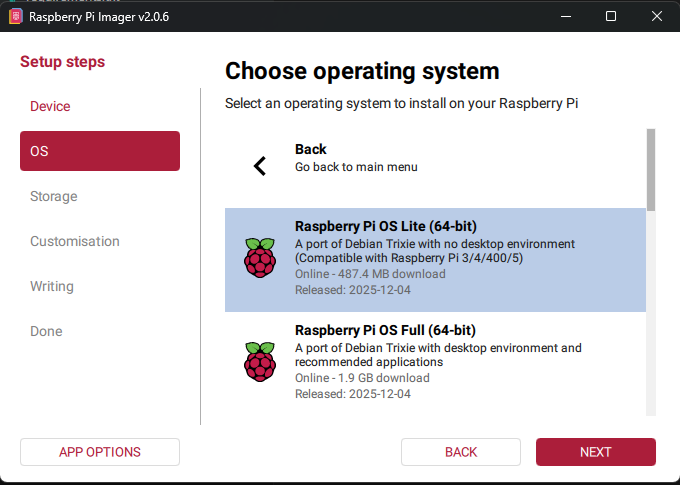

# InkDeck for Raspberry Pi

InkDeck for Raspberry Pi is an e-paper reader for a Raspberry Pi Zero 2 W and
the Waveshare 7.5 inch e-Paper HAT. It shows EPUB books in portrait, runs on a
PiSugar 2 battery, and has a few everyday apps. You manage it from a web page
on your local network.

It is the Raspberry Pi member of the InkDeck family; the
[main project](../README.md) is firmware for ESP32-S3 e-paper devices. This
edition is complete and is not under active development. It was previously
called PiBook.

## Features

- **eReader** for EPUB books, with bold and italic text, headings,
  illustrations, simple tables, cover thumbnails and saved reading positions.
  Text size, page numbers and how often the page fully refreshes are
  adjustable.
- **To Do** list: add tasks on the web, check them off on the device.
- **Network scanner** for devices on your network.
- **Klipper monitor** for 3D printers running Moonraker (Mainsail, Fluidd).
- **Terminal and word processor** for a Bluetooth or USB keyboard.
- **Web interface** for uploading books, settings, the to-do list, a
  terminal, logs and a remote control.
- **Battery savers:** sleep after inactivity, Wi-Fi off while reading, fewer
  CPU cores while reading, and optional boot-level power settings.

## What you need

- Raspberry Pi Zero 2 W and a microSD card (8 GB or more).
- Waveshare 7.5 inch e-Paper HAT, 800 × 480 black and white (V2).
- A push button between GPIO 5 (pin 29) and GND (pin 30).
- Optional: a PiSugar 2 battery. Its button can also control InkDeck.

Wiring, battery options and power tuning are in
[docs/hardware.md](docs/hardware.md).

## Installing

1. Flash **Raspberry Pi OS Lite (64-bit)** with Raspberry Pi Imager. In its
   settings, set a host name (for example `inkdeck`), a user name and password,
   your Wi-Fi network, and enable SSH.

   

2. Start the Pi, connect with `ssh <user>@inkdeck.local`, and install InkDeck.
   This downloads only the Raspberry Pi part of the repository:

   ```bash
   sudo apt update && sudo apt install -y git
   git clone --filter=blob:none --sparse https://github.com/rolohaun/Book32.git ~/InkDeck
   cd ~/InkDeck && git sparse-checkout set pi
   cd pi && ./scripts/install.sh
   sudo reboot
   ```

3. Open `http://inkdeck.local:5000` (or the address shown at the bottom of
   the main menu) and upload your books.

Any user name and install folder work. Updating from PiBook: install as
above; the installer copies books, reading positions, to-dos and settings
from `~/PiBook` and replaces the old `pibook` service.

## Using it

**The button**

- **Press:** next app, book, page or task. On the network scanner and
  Klipper screens, the first press starts a scan.
- **Hold** (about a second): open the selected app or book. Anywhere else, hold
  to return to the main menu (a book saves its place).

**PiSugar 2 button.** In the PiSugar web interface (port 8421), set a tap
action to a shell command such as:

```bash
echo next | nc -U -q1 /tmp/inkdeck-button.sock
```

The commands are `next`, `prev`, `select`, `toggle`, `back` and `home`.
`toggle` works like a long press, except that in a book it returns to the
library and on To Do it checks off the selected task.

**Keyboard.** Arrows, Page Up/Down and Space turn pages and move, Enter opens,
Esc or Backspace goes back, and Home returns to the main menu. In the Terminal
app, Alt switches between the terminal and the word processor; Ctrl+S saves a
document and Esc leaves.

**Web interface.** Port 5000. It has no login, and its terminal runs
commands on the Pi, so use it only on a network you trust. While a book is
open, Wi-Fi turns off to save power, so the web interface is unreachable
until you leave the book; turn on **Keep Wi-Fi on while reading** to change
that.

## Updating

In the web interface's Terminal, run `update`. Or over SSH:

```bash
~/InkDeck/pi/scripts/update.sh
```

Updates never touch your books or the `data/` folder.

## Files and settings

Inside the app folder (`~/InkDeck/pi`):

| Path | Contents |
| --- | --- |
| `books/` | Your EPUB books |
| `data/` | Settings, reading positions, to-dos, documents, cover and page caches |
| `config/config.yaml` | Hardware and system defaults (replaced by updates) |
| `config/local.yaml` | Your overrides of `config.yaml`, if you create it |
| `logs/inkdeck.log` | The app log, rotated at 2 MB |

Manage the service with `sudo systemctl status|restart|stop inkdeck` and see
its output with `journalctl -u inkdeck -f`.

## Troubleshooting

- **Blank display:** check that SPI is on (`ls /dev/spidev*` lists two
  devices); if not, run `sudo raspi-config nonint do_spi 0` and reboot.
- **No battery shown:** check that `pisugar-server` is running
  (`systemctl status pisugar-server`).
- **Running out of memory with large books:** `./scripts/setup_zram.sh` adds
  compressed swap.

## Development

The app runs on any computer with Python 3.10 or later: without the
Waveshare library, gpiozero or a battery it runs in mock mode and saves each
screen to `data/display.png`.

```bash
pip install -r requirements.txt pytest
python -m inkdeck          # Web interface on http://localhost:5000
python -m pytest tests
```

## License

InkDeck for Raspberry Pi is released under the MIT License; see
[LICENSE](LICENSE). The Waveshare e-Paper library that the installer downloads
has its own license.
